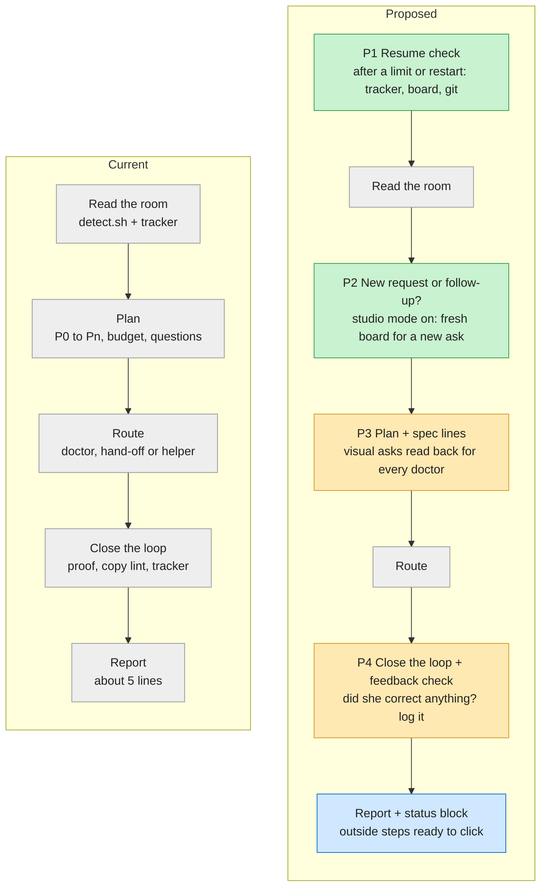
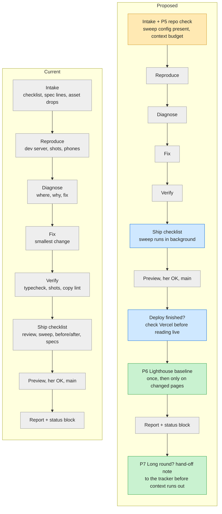
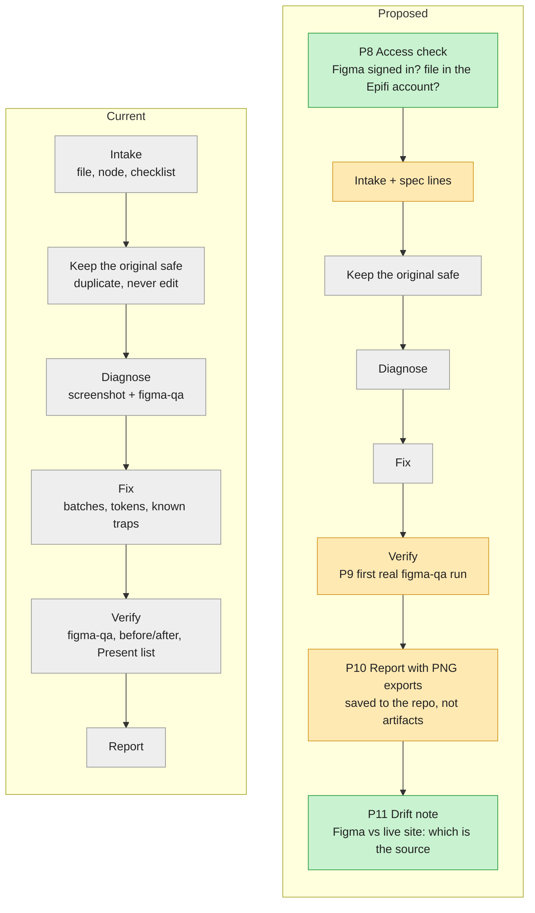
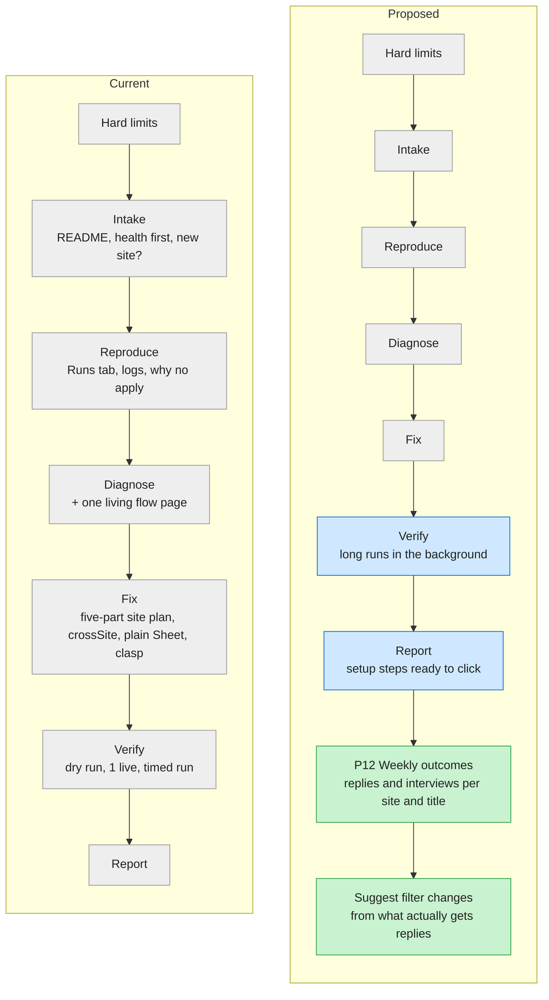

# Studio skills checkup · 23 Oct 2026

A full pass over every studio skill (studio, code-doctor, figma-doctor, flow-doctor), their reference files, the shared rules and every row in `FEEDBACK.md`. Each skill has one flowchart: **current steps on the left, proposed steps on the right.**

**Colour key in the charts**

- Grey: unchanged step
- Blue: already added today (lessons from the portfolio code chat)
- Amber: proposed change to an existing step
- Green: proposed new step

Proposals are numbered **P1 to P12** so you can answer by number. Nothing marked amber or green is live yet.

## Already done today

These came from your corrections, so they went straight into the rules (studio 0.2.1). All four feedback rows are now closed.

| Lesson | Where it lives now |
|---|---|
| Never publish claude.ai artifacts unless you ask. Reports and stats go on your site or into a repo file like this one | `shared/house-rules.md` |
| Any step you must do yourself comes with the exact link and numbered clicks | `shared/house-rules.md` |
| Production can lag a push by a minute or more: check the Vercel deployment for that commit before reading the live site | `code-doctor/ship.md` |
| The phone sweep takes about 25 minutes for 9 pages and looks idle while it works: run it in the background, never kill it early | `code-doctor/mobile.md`, `shared/house-rules.md` |
| In zsh scripts, never name a variable `path` (it wipes `PATH`) | `shared/house-rules.md` |

---

## 1. studio (the router)

| # | Proposal | Why (evidence) |
|---|---|---|
| P1 | **Resume check first.** After a usage limit, a crash or an app restart, read the tracker, the board and `git status`, then continue from the first open item without asking again | Usage limits stopped your chats at least 5 times; each time you had to say "continue" and it re-checked by hand |
| P2 | **New request or follow-up.** With studio mode on, decide whether your message is a new round (fresh board, new checklist) or more of the same (add items to the current board) | Studio mode now carries every message, so the board needs a rule for when to start over |
| P3 | **Spec read-back in the router, for every doctor.** Today only code-doctor turns visual asks into exact lines (element · property · value). Move it up so Figma work gets it too | The cat drop side and belt/bell colours were repeated twice; Figma has the same risk with colours and spacing |
| P4 | **Feedback check as a step, not just a rule.** Before every report: "did she correct something a rule should have caught?" If yes, log it | Two of the four feedback rows were logged late, from another chat |

---

## 2. code-doctor

| # | Proposal | Why (evidence) |
|---|---|---|
| P5 | **Repo check at intake.** Confirm `.studio/sweep.json` exists (cat and bubble as floaters, all case-study pages) and `.studio-proof/` is git-ignored; create them if missing. Note how much context is left before a big round | The sweep falls back to guessing floaters without the config; the code chat ran out of context once mid-round |
| P6 | **Lighthouse baseline, once.** Run it on every page now and save the numbers in the tracker, then only re-run on pages a round touched | Lighthouse is in the checklist but has never been run, so there is nothing to compare against |
| P7 | **Hand-off note before context runs out.** On long rounds, write "done, open, next" into the tracker at natural breaks so a fresh chat can pick up | The code chat was continued from a summary and lost detail |

---

## 3. figma-doctor

| # | Proposal | Why (evidence) |
|---|---|---|
| P8 | **Access check first.** Is the Figma connection signed in (if not: exact steps to sign in)? Is the file still in the Epifi account? If so, duplicate it to your personal account before the November shutdown, with ready-to-click steps | Figma has been signed out all week; your portfolio files sit in the Epifi account, which closes in November |
| P9 | **Prove figma-qa once on a real frame.** The QA script has only been syntax-checked; run it on the portfolio home frame and fix whatever it gets wrong | Untested checks give false confidence |
| P10 | **Review images in the repo.** Export before/after PNGs into the project folder (and send them in chat), never as artifacts | Artifacts get lost when you switch accounts |
| P11 | **Drift note.** When the live site and Figma differ (the cat moved past Figma rounds 8 and 9), record which one is the source of truth in the tracker, and what Figma would need to catch up | Figma fell behind the code during the cat rounds and nobody tracked it |

---

## 4. flow-doctor

| # | Proposal | Why (evidence) |
|---|---|---|
| P12 | **Weekly outcomes.** Once a week (or when you ask), read the Sheet's Status and Response columns and show replies, interviews and rejections per site and per title track, then suggest filter changes (drop tracks that never get replies, widen ones that do). An Outcomes tab in the Sheet holds it | Right now the bot learns nothing from results: it applies, but nothing tells it which roles or sites actually reply |

---

## 5. Shared files

| File | State | Note |
|---|---|---|
| `house-rules.md` | Updated today | Artifacts, outside steps, long jobs, zsh `path` added |
| `verify.md` | Good | Points to the sweep and the before/after diff |
| `truth.md` | Good | No new corrections against it |
| `taste.md` | Unused so far | No style gate has run since it was written; it stays as is |
| `handoff.md` | Good | Asset drops and feedback sections added on 20 Oct |
| `FEEDBACK.md` | All closed | 4 rows, all turned into rules |

## How to answer

Reply with the numbers you want (for example "P1, P3, P8, P12") or "all". Each one is a small edit to a `steps.md` file, and every chat picks it up on its next message without a reload.
